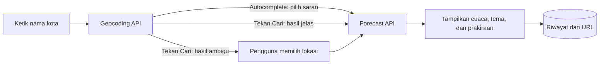

<div align="center">

# 🌤️ Weather App

**Cek cuaca saat ini, prakiraan 5 hari, dan prakiraan per jam untuk kota mana pun.**
Dibuat dengan JavaScript murni, Tailwind CSS, dan Vite. Tanpa framework, tanpa API key.

## Daftar isi

- [Fitur](#fitur)
- [Cara kerja](#cara-kerja)
- [Teknologi](#teknologi)
- [Menjalankan di lokal](#menjalankan-di-lokal)
- [Struktur project](#struktur-project)
- [Tautan yang bisa dibagikan](#tautan-yang-bisa-dibagikan)
- [Aksesibilitas dan privasi](#aksesibilitas-dan-privasi)
- [Yang saya pelajari](#yang-saya-pelajari)
- [Rencana pengembangan](#rencana-pengembangan)
- [Kredit](#kredit)

## Fitur

### 🌦️ Data cuaca

| Fitur | Keterangan |
|---|---|
| Cuaca saat ini | Suhu, suhu terasa, kelembapan, kecepatan dan arah angin |
| Detail harian | Peluang hujan, indeks UV (dengan label), jam matahari terbit dan terbenam |
| Prakiraan 5 hari | Suhu maksimum dan minimum dengan bar rentang, plus peluang hujan per hari |
| Prakiraan per jam | 24 jam ke depan, bisa digeser mendatar |
| Tips cuaca | Saran singkat otomatis, misalnya "bawa payung" |
| Satuan suhu | Toggle °C / °F tanpa mengambil data ulang |

### 🔎 Pencarian

| Fitur | Keterangan |
|---|---|
| Autocomplete | Saran lokasi saat mengetik (dengan debounce) dan navigasi keyboard |
| Pilihan lokasi | Kalau nama kota ambigu, pengguna yang memilih, bukan hasil pertama |
| Lokasi saya | Memakai Geolocation API |
| Riwayat | 5 pencarian terakhir, plus tombol kota populer dan tombol hapus riwayat |
| Bagikan | Tautan ke kota yang sedang dilihat, dengan tombol salin |

### 🎨 Tampilan

- Latar berubah mengikuti kondisi cuaca, dengan tema malam berbintang di mode gelap
- Animasi hujan di canvas saat hujan atau badai
- Dark mode otomatis mengikuti pengaturan perangkat
- Responsif, dengan skeleton loading serta penanganan error dan offline

## Cara kerja



Data cuaca selalu disimpan dalam °C. Satuan hanya memengaruhi tampilan, jadi toggle °C / °F tidak memicu request baru.

## Teknologi

| Teknologi | Kegunaan |
|---|---|
| HTML dan JavaScript (ES Modules) | Struktur dan logika aplikasi |
| Tailwind CSS v4 | Styling dengan utility class |
| Vite | Dev server dan build produksi |
| Open-Meteo API | Geocoding dan data cuaca (gratis, tanpa API key) |
| Canvas API | Animasi hujan dan bintang |
| Geolocation API | Lokasi pengguna |
| localStorage | Riwayat pencarian dan preferensi satuan |

## Menjalankan di lokal

Membutuhkan [Node.js](https://nodejs.org/) versi LTS terbaru.

```bash
git clone https://github.com/raihanamar0810/weather-app.git
cd weather-app
npm install
npm run dev
```

Buka alamat yang muncul di terminal (biasanya `http://localhost:5173`).

| Perintah | Fungsi |
|---|---|
| `npm run dev` | Menjalankan dev server |
| `npm run build` | Build produksi ke folder `dist` |
| `npm run preview` | Melihat hasil build secara lokal |

## Struktur project

```
weather-app/
├── docs/            # screenshot untuk dokumentasi
├── public/          # aset statis
├── src/
│   ├── main.js      # logika aplikasi dan tampilan
│   └── style.css    # Tailwind dan gaya khusus (tema, animasi)
├── index.html
├── vite.config.js
└── package.json
```

## Tautan yang bisa dibagikan

Kota yang sedang dilihat tercermin di URL, sehingga bisa disalin atau dibuka ulang.

| Parameter | Contoh | Keterangan |
|---|---|---|
| `kota` | `Bandung` | Nama lokasi (wajib) |
| `lat`, `lon` | `-6.92`, `107.61` | Koordinat. Jika ada, cuaca langsung ditampilkan |
| `provinsi`, `negara` | `Jawa Barat`, `Indonesia` | Opsional, hanya untuk label |

```
?kota=Bandung&lat=-6.92&lon=107.61&provinsi=Jawa%20Barat&negara=Indonesia
```

Tautan sederhana seperti `?kota=Bandung` juga berfungsi lewat pencarian biasa. Koordinat dari URL divalidasi sebelum dipakai.

## Aksesibilitas dan privasi

**Keyboard**

| Tombol | Fungsi |
|---|---|
| `↓` / `↑` | Berpindah antar saran autocomplete |
| `Enter` | Memilih saran atau menjalankan pencarian |
| `Esc` | Menutup daftar saran |
| `Tab` | Berpindah antar kontrol, dengan garis fokus yang jelas |

**Lainnya**
- Pola ARIA combobox untuk autocomplete, `aria-live` untuk pesan status, dan `role="alert"` untuk error
- Animasi dimatikan atau dikurangi untuk pengguna dengan pengaturan "kurangi animasi"

**Privasi**
- Lokasi dari tombol "Lokasi saya" dibulatkan (sekitar 1 km) dan **tidak** dimasukkan ke URL maupun riwayat
- Riwayat dan preferensi hanya disimpan di browser pengguna (`localStorage`)

## Yang saya pelajari

- Memanggil dua API secara berurutan dengan `async/await`, serta membedakan error jaringan dari response non-OK (`res.ok`)
- Mencegah hasil request lama menimpa yang baru (race condition) memakai nomor pencarian
- Debounce untuk autocomplete dan pola ARIA combobox yang dapat diakses keyboard
- Menyimpan data di `localStorage` dengan aman (`try/catch`) dan memvalidasi data dari URL
- Membuat animasi canvas yang ringan dan menghormati `prefers-reduced-motion`
- Menyusun tampilan responsif dan tema (terang, gelap, malam) dengan Tailwind CSS

## Catatan

- Di komputer desktop, lokasi dari tombol "Lokasi saya" biasanya diperkirakan dari jaringan, sehingga bisa meleset beberapa kilometer.
- Data prakiraan berasal dari model cuaca Open-Meteo, jadi bisa sedikit berbeda dari aplikasi cuaca lain.

## Kredit

Data cuaca dan geocoding disediakan oleh [Open-Meteo.com](https://open-meteo.com/).

---

<div align="center">

Dibuat oleh [Muhammad Raihan Amar Ma'ruf](https://github.com/raihanamar0810)

</div>
